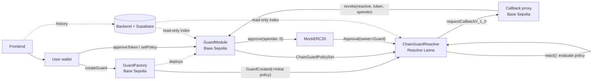

# Architecture

## Security model
- **Guard-as-owner.** `GuardModule` holds the tokens and is the ERC-20 `owner` of every allowance it grants. Revocation is `token.approve(spender, 0)` called by the Guard itself — there is no way to revoke an arbitrary EOA's approvals, and the product does not claim one.
- **Callback auth.** `GuardModule.revoke(address,address,address)` is guarded by `onlyServiceProvider` (caller must be the Base Sepolia callback proxy) and `onlyCallbackSender` (the proxy-injected first argument must equal the immutable `ChainGuardReactive` address). The first payload argument is `address(0)` when encoded; the network overwrites it with the reactive contract address.
- **Policy decided in `react()`.** `ChainGuardReactive` keeps a mirror of each Guard's policy (`enabled`, `revokeUnlimited`, `maxAllowance`). `react()` decodes `Approval`, looks up the policy keyed by the Guard (topic1), and calls `SYSTEM.requestCallbackV_1_0` only when the policy says revoke.
- **Trusted-factory registration.** `ChainGuardReactive` subscribes only to the trusted `GuardFactory`'s `GuardCreated` (set once by the admin via `setFactory`). `GuardCreated` carries the Guard's initial policy, because the Guard emits its constructor `ChainGuardPolicySet` *before* Lasna could be subscribed to it.
- **Runtime, Guard-scoped subscriptions.** Inside `react()`, on a valid `GuardCreated`, the contract registers the Guard and subscribes (Reactive Omni supports subscribing from `react()`) to: (a) that Guard's own `ChainGuardPolicySet` (`contract = guard`), and (b) `Approval` on each allowlisted token with `topic1 = guard`. No subscription uses a wildcard emitter, so unrelated contracts cannot make `react()` run.
- **Readiness handshake.** After requesting the subscriptions, `react()` calls back the Guard (`confirmRegistered`, proxy + trusted-reactive auth). The Guard rejects `approveToken`/`setPolicy` (`NotProtected`) until confirmed, and afterwards rejects tokens outside the confirmed allowlist (`UnsupportedToken`). `withdraw`/`revokeManually` are never blocked. This replaces any fixed delay; it signals that registration ran, not that Lasna has activated the subscriptions (undocumented).
- **Only registered Guards matter.** `react()` re-checks: `GuardCreated` must come from the trusted factory; a policy event is accepted only from a registered Guard; an `Approval` is evaluated only if the owner is a registered Guard **and** the token is allowlisted. Anything else is ignored (no state change, no callback).
- **Bounded exposure.** The token allowlist is fixed at construction (≤ 8) and the number of registered Guards is capped by `maxGuards`; extra Guards are rejected without any further subscriptions.
- **Residual cost model.** A registered Guard's owner can still cause `react()` runs for their *own* Guard (e.g. by approving repeatedly); the cap bounds the number of such owners. A production system would charge owners (prepaid fee per Guard).
- **Known limits.** A policy change emitted before the Guard's runtime subscription is active (first seconds after creation) is not seen; the UI shows when Lasna's mirrored policy differs. Tokens added later are not watched for existing Guards.

## Why this needs Reactive (and what it does not claim)
The owner can always approve something unwise, and an on-chain `require` inside the Guard could block *unlimited* approvals. What an on-chain check cannot do is a policy that is **changed and enforced after the fact**: the trusted-spender allowlist is evaluated on Lasna against the live `Approval` stream, so removing a spender from the list (or turning the mode on) means the next approval to it is cleaned up without any keeper bot. Limits: a revoke lands after the approval, not before — a bot that drains in the same moment is not stopped; ChainGuard bounds the window for approvals that are forgotten or granted through a tool you did not fully inspect.

## Subscriptions
0. (Policy surface) The Guard publishes `ChainGuardPolicySet`, `SpenderModeSet` and `SpenderRuleSet`; `react()` mirrors all three and evaluates them together with the `Approval`.
1. `setFactory(factory)` → `GuardCreated` of that one factory contract only.
2. Per registered Guard (added at runtime inside `react()`): the Guard's `ChainGuardPolicySet`, `SpenderModeSet` and `SpenderRuleSet`, and `Approval` on each allowlisted token filtered to `owner = guard`.
ERC-721 `Approval` (4 topics) is ignored via `opCode == 3`.

## Funding
Lasna: reactive contract must hold lREACT. Base Sepolia: each Guard pays callback gas in ETH (Factory forwards `msg.value`; `receive()` and `depositTo()` also work). Debt blocks delivery.

## Backend / frontend separation
The backend (Express + Supabase) only **indexes** logs (idempotent on chain id + tx hash + log index) and stores tx status (`pending → confirmed|failed`). It holds no keys and cannot sign. The frontend reads live state (policy, allowance, logs) straight from the chains, so the dashboard — and the security loop — work with the backend down.
