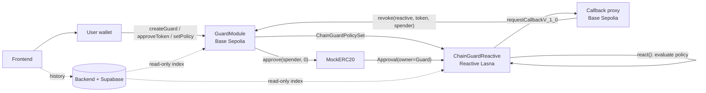

# Architecture

## Security model
- **Guard-as-owner.** `GuardModule` holds the tokens and is the ERC-20 `owner` of every allowance it grants. Revocation is `token.approve(spender, 0)` called by the Guard itself — there is no way to revoke an arbitrary EOA's approvals, and the product does not claim one.
- **Callback auth.** `GuardModule.revoke(address,address,address)` is guarded by `onlyServiceProvider` (caller must be the Base Sepolia callback proxy) and `onlyCallbackSender` (the proxy-injected first argument must equal the immutable `ChainGuardReactive` address). The first payload argument is `address(0)` when encoded; the network overwrites it with the reactive contract address.
- **Policy decided in `react()`.** `ChainGuardReactive` keeps a mirror of each Guard's policy (`enabled`, `revokeUnlimited`, `maxAllowance`). `react()` decodes `Approval`, looks up the policy keyed by the Guard (topic1), and calls `SYSTEM.requestCallbackV_1_0` only when the policy says revoke.
- **Policy transport.** The Guard emits `ChainGuardPolicySet` (also at construction). The reactive contract is subscribed to that topic on Base Sepolia and stores it keyed by the *emitting* address, so a forged event can only configure the forger's own address.
- **Revocation is idempotent and revoke-only.** The worst a compromised callback path could do is set an allowance to zero.

## Subscriptions
1. `ChainGuardPolicySet` — any contract on Base Sepolia (wildcard emitter).
2. `Approval` — per watched token (constructor list, `watchToken` for admin additions). ERC-721 `Approval` (4 topics) is ignored via `opCode == 3`.

## Funding
Lasna: reactive contract must hold lREACT. Base Sepolia: each Guard pays callback gas in ETH (Factory forwards `msg.value`; `receive()` and `depositTo()` also work). Debt blocks delivery.

## Backend / frontend separation
The backend (Express + Supabase) only **indexes** logs (idempotent on chain id + tx hash + log index) and stores tx status (`pending → confirmed|failed`). It holds no keys and cannot sign. The frontend reads live state (policy, allowance, logs) straight from the chains, so the dashboard — and the security loop — work with the backend down.
